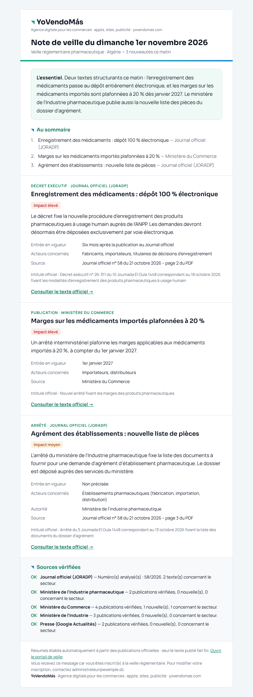
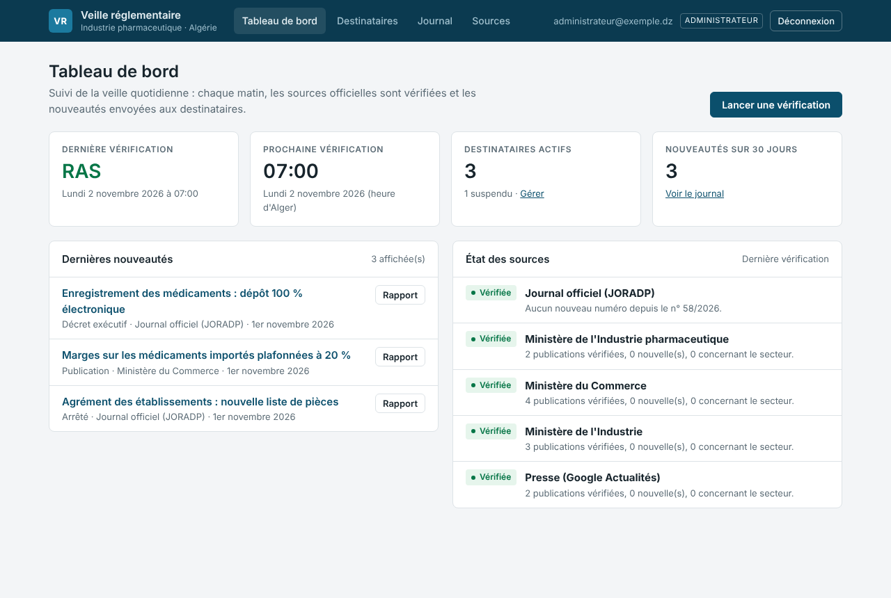
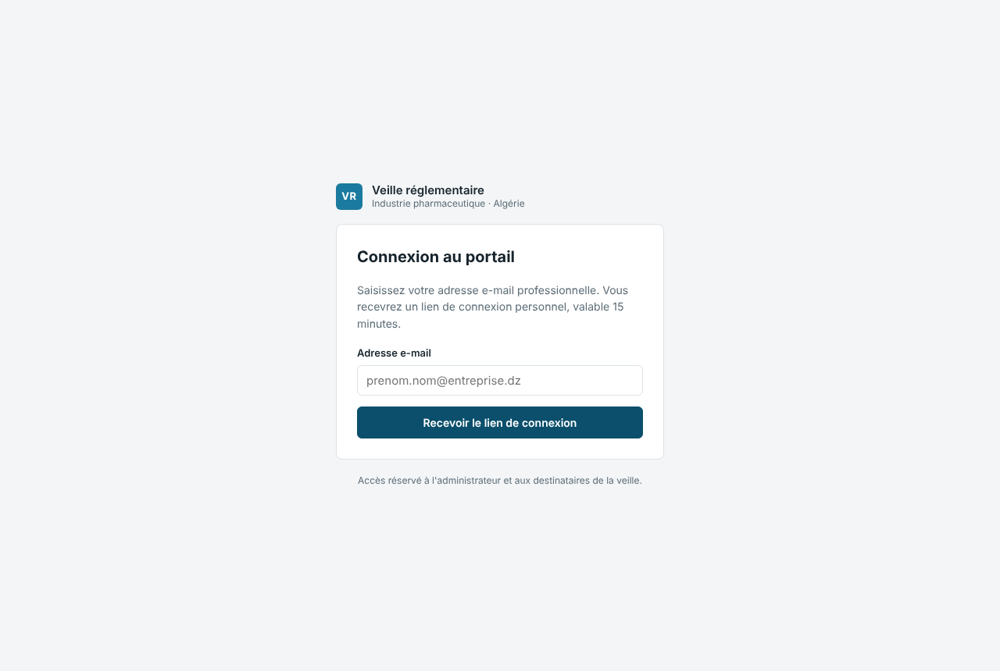
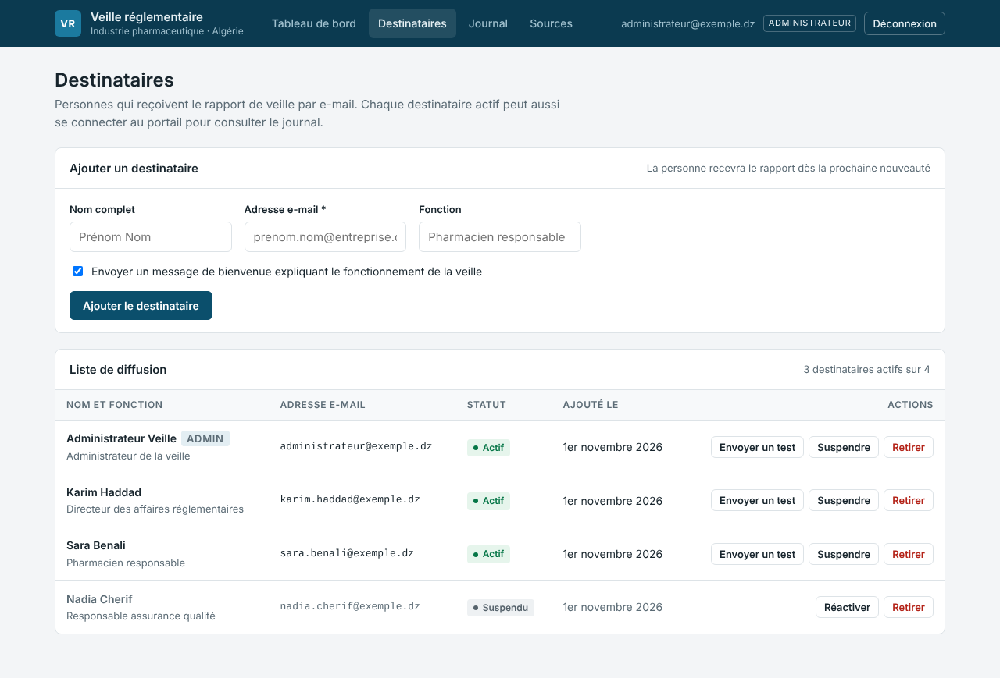
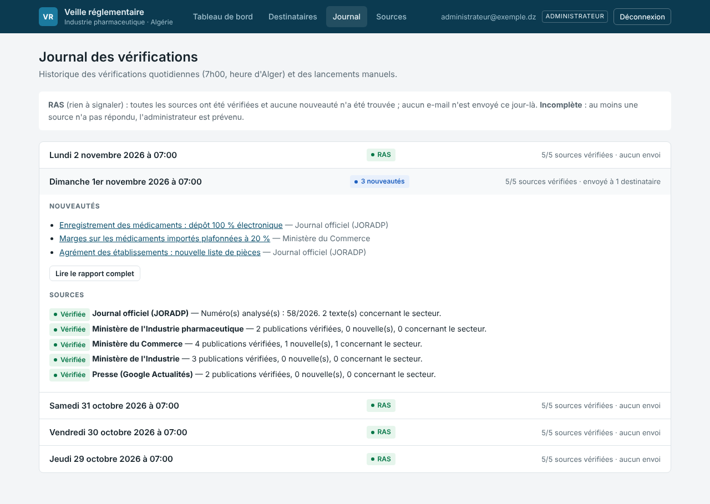

# Veille réglementaire – Industrie pharmaceutique (Algérie)

Logiciel de *regulatory intelligence* qui tourne **seul, dans le cloud Microsoft (Azure)**.
Il ne dépend ni de Claude, ni de Copilot, ni d'un ordinateur allumé.

## En bref

- **Chaque matin à 7h00 (heure d'Alger)**, Azure lance la vérification des sources officielles :
  Journal officiel, ministères de l'Industrie pharmaceutique, du Commerce et de l'Industrie, et la presse.
- **S'il y a du nouveau**, les destinataires reçoivent une **note de veille** par e-mail : sommaire,
  résumé de chaque texte, impact, entrée en vigueur, acteurs concernés et lien vers le texte officiel.
- **S'il n'y a rien**, aucun e-mail n'est envoyé. Le portail indique **RAS** (rien à signaler).
- **Un portail web** permet à l'**administrateur** de gérer la liste des destinataires et de suivre la
  veille. Les destinataires peuvent s'y connecter pour consulter le journal des vérifications.

| Note de veille reçue par e-mail | Portail : tableau de bord de l'administrateur |
|---|---|
|  |  |

*(Captures réalisées avec des données fictives.)*

---

## Le portail

Adresse : `https://<nom-de-l-application>.azurewebsites.net/`

### Connexion sans mot de passe

La personne saisit son adresse e-mail et reçoit un **lien de connexion personnel**. Ce lien est
valable 15 minutes et ne sert qu'une fois. La session reste ouverte 12 heures.

- Seuls l'**administrateur** et les **destinataires actifs** peuvent se connecter. Une adresse
  inconnue ne reçoit rien, et la page affichée est la même, pour ne pas révéler qui a accès.
- Retirer ou suspendre un destinataire lui **coupe l'accès immédiatement**.
- Au plus 5 demandes de lien par heure et par adresse.



### Rôles

| | Administrateur | Destinataire |
|---|---|---|
| Qui | Adresse(s) indiquée(s) dans le paramètre Azure `VEILLE_ADMINS` | Personnes ajoutées par l'administrateur |
| Reçoit la note de veille | Oui (il figure dans la liste au départ, il peut se retirer) | Oui, tant qu'il est actif |
| Tableau de bord, destinataires, sources | ✓ | — |
| Journal des vérifications et rapports archivés | ✓ | ✓ |
| Lancer une vérification à la demande | ✓ | — |

### Pages de l'administrateur

- **Tableau de bord** : dernière vérification (RAS, nouveautés ou incomplète), heure de la prochaine,
  nombre de destinataires, nouveautés des 30 derniers jours, état de chaque source, bouton
  « Lancer une vérification ».
- **Destinataires** : ajouter une personne (nom, adresse, fonction), avec un message de bienvenue
  facultatif qui explique le fonctionnement. Pour chaque personne : **envoyer un e-mail de test**,
  **suspendre / réactiver**, **retirer**.
- **Journal** : chaque vérification, avec le détail par source et le rapport complet archivé.
- **Sources** : liste des sources surveillées et résultat de leur dernière vérification.

| Destinataires | Journal |
|---|---|
|  |  |

---

## Installation par vous-même (environ 15 minutes, depuis le navigateur)

Rien à installer sur votre ordinateur, et aucun service informatique nécessaire : tout se fait dans
**Azure Cloud Shell**, un terminal Microsoft qui s'ouvre dans le navigateur. Les e-mails partent par
le **service d'e-mail d'Azure** : aucune messagerie d'entreprise n'est utilisée.

1. **Créez un compte Azure** sur https://azure.microsoft.com/free (une carte bancaire est demandée
   pour vérifier l'identité ; le coût de la veille reste de l'ordre de quelques euros par mois au plus).
2. **Ouvrez** https://shell.azure.com et choisissez **Bash**. La première fois, acceptez la création
   de l'espace de stockage proposé.
3. **Chargez le fichier** `veille-pharma-dz.zip` : bouton **Gérer les fichiers** (ou l'icône
   d'envoi) → **Charger**.
4. **Collez cette commande**, en mettant les adresses des administrateurs, puis appuyez sur Entrée :

   ```bash
   unzip -o veille-pharma-dz.zip && bash veille-pharma-dz/installer.sh premier.admin@exemple.com second.admin@exemple.com
   ```

5. **Attendez la fin** (5 à 15 minutes). Le script affiche l'**adresse du portail**.
6. **Envoyez cette adresse aux administrateurs.** Chacun s'y connecte avec son adresse e-mail,
   ajoute les destinataires et lance la première vérification.

Pour **mettre à jour** le logiciel plus tard : recharger le nouveau .zip et relancer la même commande
(sans les adresses, elles sont retenues). Pour **tout supprimer** : `az group delete -n veille-pharma`.

> Les e-mails partent d'une adresse du type `DoNotReply@xxxx.azurecomm.net`. Au premier envoi,
> vérifiez les courriers indésirables et ajoutez cette adresse aux expéditeurs approuvés.
> Pour envoyer depuis votre propre nom de domaine, il suffit de le relier au service d'e-mail Azure.

---

## Installation manuelle (avancé, par exemple avec la messagerie Microsoft 365 d'une entreprise)

### Ce qu'il faut

- Un **abonnement Azure**.
- Un compte **Microsoft 365** avec une boîte mail expéditrice, par exemple `veille@votre-entreprise.com`
  (une boîte partagée suffit).
- *(Recommandé)* Un accès **Azure OpenAI** pour rédiger les résumés. Sans lui, la note reprend
  l'article 1er de chaque texte officiel.

> Dans une grande entreprise, la création d'une application Azure et la permission d'envoi d'e-mails
> (`Mail.Send`) passent en général par le service informatique : prévoyez sa validation.

### Étape 1 – Créer la Function App

Portail Azure → **Créer une ressource** → **Function App** :

- Plan d'hébergement : **Flex Consumption** (paiement à l'usage, quasi gratuit pour 1 exécution par jour)
- Pile d'exécution : **Python 3.11** (ou plus récent proposé)
- Région : par exemple *France Central* ou *West Europe*
- Le compte de stockage créé avec elle garde aussi le journal, les rapports et la liste des destinataires.

### Étape 2 – Autoriser l'envoi d'e-mails (Microsoft 365)

Portail Azure → **Microsoft Entra ID** → **Inscriptions d'applications** → **Nouvelle inscription**
(nom : « Veille réglementaire ») :

1. **Autorisations d'API** → Ajouter → **Microsoft Graph** → *Autorisations d'application* →
   **Mail.Send** → **Accorder le consentement administrateur**.
2. **Certificats et secrets** → *Nouveau secret client* → copier la **valeur**.
3. Noter l'**ID d'annuaire (tenant)** et l'**ID d'application (client)**.

> 🔒 Recommandé : dans Exchange Online, limitez cette application à la seule boîte expéditrice
> (« RBAC for Applications »).

### Étape 3 – *(Recommandé)* Azure OpenAI

Créez une ressource Azure OpenAI et **déployez un modèle « mini »**. Notez le point de terminaison,
la clé et le nom du déploiement.

### Étape 4 – Paramètres de la Function App

Function App → **Paramètres** → **Variables d'environnement** :

| Nom | Valeur | Rôle |
|---|---|---|
| `VEILLE_ADMINS` | adresse de l'administrateur | Qui administre le portail (plusieurs adresses séparées par des virgules) |
| `VEILLE_SECRET` | une longue suite aléatoire (ex. `openssl rand -hex 32`) | Signe les sessions du portail. Ne pas la communiquer |
| `VEILLE_URL_PUBLIQUE` | `https://<nom>.azurewebsites.net` | Adresse du portail, utilisée dans les liens des e-mails |
| `VEILLE_PLANNING` | `0 0 6 * * *` | Tous les jours à 6h UTC = **7h00 à Alger** |
| `VEILLE_MODE_EMAIL` | `graph` | Envoi via Microsoft 365 (`acs` : service d'e-mail Azure, avec `ACS_CONNEXION` et `ACS_EXPEDITEUR`) |
| `GRAPH_TENANT_ID` | *(étape 2)* | |
| `GRAPH_CLIENT_ID` | *(étape 2)* | |
| `GRAPH_CLIENT_SECRET` | *(étape 2)* | Idéalement via une référence Key Vault |
| `GRAPH_EXPEDITEUR` | `veille@votre-entreprise.com` | Boîte qui envoie |
| `AZURE_OPENAI_ENDPOINT` | `https://….openai.azure.com/` | *(étape 3)* |
| `AZURE_OPENAI_API_KEY` | *(étape 3)* | |
| `AZURE_OPENAI_DEPLOYMENT` | nom du déploiement | |
| `VEILLE_ORGANISATION` | *(facultatif)* nom de votre entité | Affiché dans le portail et les e-mails |
| `VEILLE_ALERTE_ADMIN` | *(facultatif)* | Destinataires des alertes techniques (par défaut : l'administrateur) |

Les destinataires ne se règlent **pas** ici : l'administrateur les gère depuis le portail.

### Étape 5 – Déployer le code

Depuis ce dossier `veille-pharma-dz`, au choix :

- **VS Code** avec l'extension *Azure Functions* : clic droit sur le dossier → *Deploy to Function App…*
- ou en ligne de commande : `func azure functionapp publish <nom-de-la-function-app>`

### Étape 6 – Première connexion

1. Ouvrez `https://<nom>.azurewebsites.net/` et saisissez l'adresse de l'administrateur. Cliquez sur
   le lien reçu par e-mail, puis sur **Ouvrir ma session**.
2. Dans **Destinataires**, ajoutez les personnes qui recevront la note de veille.
3. Dans le **Tableau de bord**, cliquez sur **Lancer une vérification**. La première sert de point
   de départ : elle mémorise le dernier numéro du JO et les publications existantes, et affiche
   **RAS**. Chaque source doit apparaître « Vérifiée ». Une source en « Échec » a une adresse à
   corriger dans `sources.yaml`.
4. Dès le lendemain, la veille tourne seule chaque matin.

> Pour recevoir une première note de test, mettez `numeros_a_rattraper: 5` dans `sources.yaml` avant
> le premier lancement : les 5 derniers numéros du JO seront analysés.

---

## Sources

Elles se règlent dans **`sources.yaml`**, sans toucher au code : ajout, suppression, mots-clés,
exclusions.

| Source | Méthode | État |
|---|---|---|
| Journal officiel (joradp.dz) | Détection du numéro suivant, lecture du PDF complet | Activée. Format d'adresse des PDF à confirmer au 1er lancement |
| Ministère de l'Industrie pharmaceutique (miph.gov.dz) | Fil d'actualités | Activée. Adresse du fil à confirmer au 1er lancement |
| Ministère du Commerce (commerce.gov.dz) | Nouvelles publications | Activée |
| Ministère de l'Industrie (industrie.gov.dz) | Nouvelles publications | Activée |
| ANPP | Nouvelles publications | **Désactivée** : adresse à confirmer |
| Ministère de la Santé | Nouvelles publications | **Désactivée** : adresse à confirmer |
| Presse (Google Actualités) | Recherche sur 7 jours | Activée |

**Comment un texte est retenu :** il contient un mot-clé du secteur (médicament, pharmaceutique,
ANPP, officine, dispositif médical…) dans son **titre**, ou il est publié sous l'en-tête du
**ministère de l'Industrie pharmaceutique**, ou il cite ces mots plusieurs fois dans son **contenu**.
Les mentions dans les « Vu… » (visas) ne comptent pas. Les nominations et virements de crédits sont
écartés. Avec Azure OpenAI, l'IA écarte en plus les faux positifs, qui restent listés dans le journal.

**Fiabilité :**

- Le logiciel vérifie chaque matin que le dernier numéro connu du JO reste accessible. Si ce n'est
  pas le cas, il signale une erreur au lieu de conclure « rien de nouveau ».
- Un PDF du JO illisible est **quand même signalé** dans la note (« à consulter manuellement »).
- Si l'envoi de la note échoue, les nouveautés sont **renvoyées le lendemain** et l'administrateur
  est prévenu.

---

## Pour les développeurs

```
veille-pharma-dz/
├── function_app.py        # Azure Functions : minuteur quotidien + portail web
├── installer.sh           # installation complète en une commande (Azure Cloud Shell)
├── sources.yaml           # sources, mots-clés, exclusions
├── veille/
│   ├── runner.py          # une vérification : sources → note → e-mail ou RAS → journal
│   ├── sources/joradp.py  # Journal officiel : détection, lecture PDF, découpage en textes
│   ├── sources/web.py     # pages web et flux RSS/Atom
│   ├── summarize.py       # rédaction (Azure OpenAI ou extrait officiel)
│   ├── render.py          # e-mails : note de veille, alerte, lien de connexion, bienvenue, test
│   ├── portail.py         # routes du portail, rôles, actions
│   ├── ui.py              # pages HTML du portail
│   ├── annuaire.py        # administrateurs et destinataires
│   ├── securite.py        # liens de connexion à usage unique, sessions signées, anti-CSRF
│   ├── mailer.py          # service d'e-mail Azure / Microsoft Graph / SMTP / fichier
│   └── storage.py         # Blob Azure ou dossier local
└── tests/                 # 40 tests (faux JO en PDF, faux sites, parcours du portail)
```

Essais en local (Python 3.11+) :

```bash
python -m venv .venv && . .venv/bin/activate
pip install -r requirements-dev.txt
pytest tests                                   # tests automatiques
VEILLE_ADMINS=vous@exemple.com python -m veille serveur
                                               # portail sur http://127.0.0.1:8000
                                               # (liens de connexion dans donnees/boite_envoi/)
python -m veille sources                       # teste l'accès réel à chaque source
python -m veille jo 2026 57                    # analyse un numéro précis du Journal officiel
python -m veille lancer                        # vérification complète
```

## Coût indicatif

Il s'agit d'un ordre de grandeur, à vérifier sur votre abonnement :

- Function App (Flex Consumption) : une exécution par jour et quelques visites du portail restent
  dans la gratuité mensuelle.
- Stockage : quelques centimes par mois.
- Azure OpenAI (modèle « mini ») : quelques centimes les jours où il y a des nouveautés.

## Limites

- C'est l'édition **française** du JO qui est analysée. En cas de doute, la version arabe fait foi.
- Le découpage du JO repose sur sa mise en forme habituelle (« Décret exécutif n° … »,
  « Arrêté du … »).
- Si un site change d'adresse ou de structure, la veille le signale (« Vérification incomplète ») et
  il faut corriger `sources.yaml`.
- Les résumés sont automatiques : seul le texte officiel fait foi.
