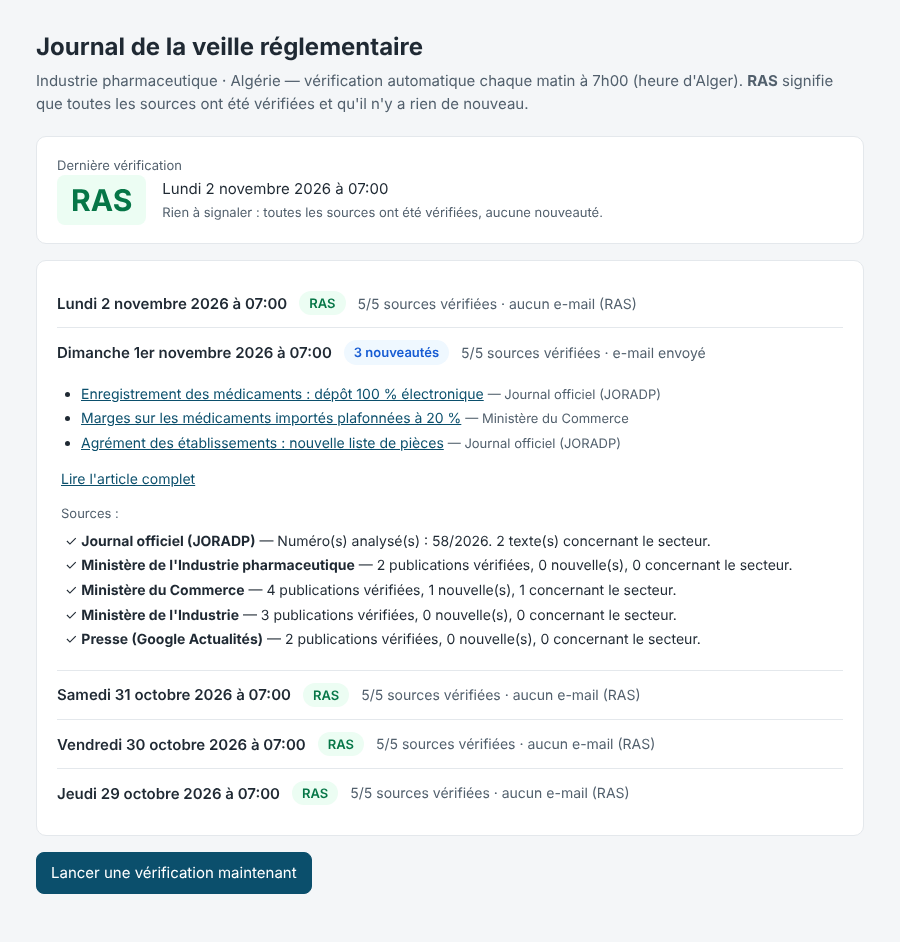

# Veille réglementaire – Industrie pharmaceutique (Algérie)

Logiciel de *regulatory intelligence* qui tourne **seul, dans le cloud Microsoft (Azure)**.
Il ne dépend ni de Claude, ni de Copilot, ni d'un ordinateur allumé.

## Ce qu'il fait

Chaque matin à **7h00 (heure d'Alger)**, Azure lance automatiquement la vérification :

1. **Journal officiel (JORADP)** : chaque nouveau numéro est téléchargé et lu en entier
   (lois, ordonnances, décrets présidentiels et exécutifs, arrêtés ministériels et
   interministériels, décisions).
2. **Sites officiels** : ministère de l'Industrie pharmaceutique, ministère du Commerce
   (intérieur et extérieur), ministère de l'Industrie (et l'ANPP et la Santé une fois leurs adresses
   confirmées).
3. **Presse** (Google Actualités) : filet de sécurité pour ce qui n'apparaît pas encore ailleurs.

Ensuite :

- **S'il y a du nouveau**, un e-mail part. C'est un court article clair : un résumé par texte,
  l'impact, l'entrée en vigueur, les acteurs concernés, la source et **le lien vers le texte officiel**.
- **S'il n'y a rien**, aucun e-mail n'est envoyé. Le **journal** indique **RAS**.
- **Si une source n'a pas pu être vérifiée** (site en panne, adresse modifiée), le journal
  n'indique **pas** RAS mais « Vérification incomplète ». Une alerte technique est envoyée.
  Un RAS veut donc toujours dire « tout a été vérifié et il n'y a rien ».

| E-mail reçu quand il y a du nouveau | Journal consultable à tout moment |
|---|---|
|  |  |

*(Exemples générés avec des données fictives.)*

Le **journal** est une page web privée : une adresse avec une clé, à mettre en favori. On y voit
chaque vérification (date, heure, RAS ou nouveautés, détail par source). Un bouton
**« Lancer une vérification maintenant »** permet de relancer à la demande.

---

## Installation (à confier à votre informaticien, environ 1 heure)

### Ce qu'il faut

- Un **abonnement Azure** (celui de l'entreprise ou un nouveau).
- Un compte **Microsoft 365** avec une boîte mail expéditrice, par exemple
  `veille@votre-entreprise.dz` (une boîte partagée suffit).
- *(Recommandé)* Un accès **Azure OpenAI** pour rédiger les résumés. Sans lui, le logiciel
  fonctionne quand même : il reprend l'article 1er de chaque texte officiel à la place du résumé.

### Étape 1 – Créer la Function App

Portail Azure → **Créer une ressource** → **Function App** :

- Plan d'hébergement : **Flex Consumption** (paiement à l'usage, quasi gratuit pour 1 exécution par jour)
- Pile d'exécution : **Python 3.11** (ou plus récent proposé)
- Région : par exemple *France Central* ou *West Europe*
- Le compte de stockage est créé automatiquement : il sert aussi à garder le journal et l'état de la veille.

### Étape 2 – Autoriser l'envoi d'e-mails (Microsoft 365)

Portail Azure → **Microsoft Entra ID** → **Inscriptions d'applications** → **Nouvelle inscription**
(nom : « Veille pharma ») :

1. **Autorisations d'API** → Ajouter → **Microsoft Graph** → *Autorisations d'application* →
   **Mail.Send** → puis **Accorder le consentement administrateur**.
2. **Certificats et secrets** → *Nouveau secret client* → copier la **valeur**.
3. Noter l'**ID d'annuaire (tenant)** et l'**ID d'application (client)** (page *Vue d'ensemble*).

> 🔒 Recommandé : dans Exchange Online, limitez cette application à la seule boîte expéditrice
> (« RBAC for Applications »). Sinon, elle a le droit d'envoyer au nom de n'importe quelle boîte.

### Étape 3 – *(Recommandé)* Azure OpenAI

Dans Azure AI Foundry, créez une ressource Azure OpenAI et **déployez un modèle « mini »**
(peu coûteux, largement suffisant). Notez le **point de terminaison**, la **clé** et le **nom du déploiement**.

### Étape 4 – Paramètres de la Function App

Function App → **Paramètres** → **Variables d'environnement** → ajoutez :

| Nom | Valeur | Rôle |
|---|---|---|
| `VEILLE_PLANNING` | `0 0 6 * * *` | Tous les jours à 6h UTC = **7h00 à Alger** |
| `VEILLE_DESTINATAIRES` | `a@entreprise.dz, b@entreprise.dz` | Qui reçoit les nouveautés |
| `VEILLE_ALERTE_ADMIN` | `informatique@entreprise.dz` | Qui reçoit les alertes techniques |
| `VEILLE_MODE_EMAIL` | `graph` | Envoi via Microsoft 365 |
| `GRAPH_TENANT_ID` | *(étape 2)* | |
| `GRAPH_CLIENT_ID` | *(étape 2)* | |
| `GRAPH_CLIENT_SECRET` | *(étape 2)* | Idéalement via une référence Key Vault |
| `GRAPH_EXPEDITEUR` | `veille@entreprise.dz` | Boîte qui envoie |
| `AZURE_OPENAI_ENDPOINT` | `https://….openai.azure.com/` | *(étape 3)* |
| `AZURE_OPENAI_API_KEY` | *(étape 3)* | |
| `AZURE_OPENAI_DEPLOYMENT` | nom du déploiement | |
| `VEILLE_URL_JOURNAL` | *(étape 6)* | Lien vers le journal, ajouté en bas des e-mails |

Le stockage est détecté automatiquement (`AzureWebJobsStorage`).

### Étape 5 – Déployer le code

Depuis ce dossier `veille-pharma-dz`, au choix :

- **VS Code** avec l'extension *Azure Functions* : clic droit sur le dossier → *Deploy to Function App…*
- ou en ligne de commande : `func azure functionapp publish <nom-de-la-function-app>`

Azure installe lui-même les dépendances (`requirements.txt`).

### Étape 6 – Vérifier

1. Function App → **Fonctions** → `journal` → **Obtenir l'URL de la fonction**. Ouvrez-la et mettez-la
   en favori : c'est la page du journal. Copiez-la aussi dans `VEILLE_URL_JOURNAL`.
2. Cliquez sur **« Lancer une vérification maintenant »**.
   - La **première** vérification sert de point de départ : elle mémorise le dernier numéro du JO et
     les publications existantes. Elle affiche **RAS** et chaque source doit apparaître avec ✓.
   - Une source en ⚠ veut dire que son adresse est à corriger dans `sources.yaml`
     (voir « Sources » ci-dessous).
3. Dès le lendemain, la veille tourne seule chaque matin.

> Pour recevoir un premier e-mail de test, mettez `numeros_a_rattraper: 5` dans `sources.yaml`
> avant le premier lancement. Les 5 derniers numéros du JO seront alors analysés.

---

## Sources

Elles se règlent dans **`sources.yaml`**, sans toucher au code : ajout, suppression, mots-clés,
exclusions.

| Source | Méthode | État |
|---|---|---|
| Journal officiel (joradp.dz) | Détection du numéro suivant, lecture du PDF complet | Activée. Format d'adresse des PDF repris d'un index public, à confirmer au 1er lancement |
| Ministère de l'Industrie pharmaceutique (miph.gov.dz) | Flux d'actualités | Activée. Adresse du flux à confirmer au 1er lancement |
| Ministère du Commerce (commerce.gov.dz) | Nouveaux liens de la page | Activée |
| Ministère de l'Industrie (industrie.gov.dz) | Nouveaux liens de la page | Activée |
| ANPP | Nouveaux liens de la page | **Désactivée** : adresse à confirmer |
| Ministère de la Santé | Nouveaux liens de la page | **Désactivée** : adresse à confirmer |
| Presse (Google Actualités) | Recherche sur 7 jours | Activée |

**Comment un texte est retenu :** il doit contenir un mot-clé du secteur (médicament, pharmaceutique,
ANPP, officine, dispositif médical…) dans son **titre**, ou être publié sous l'en-tête du
**ministère de l'Industrie pharmaceutique**, ou citer ces mots plusieurs fois dans son **contenu**.
Les mentions dans les « Vu… » (visas) ne comptent pas. Les nominations et virements de crédits sont
écartés. Si Azure OpenAI est configuré, l'IA écarte en plus les faux positifs. Ils restent listés
dans le journal (« Écartés après analyse »), pour plus de transparence.

**Fiabilité :**

- Chaque matin, le logiciel vérifie que le dernier numéro connu du JO est toujours accessible. Si ce
  n'est pas le cas, il signale une erreur au lieu de conclure « rien de nouveau ».
- Si un PDF du JO ne peut pas être lu, il est **quand même signalé** dans l'e-mail
  (« à consulter manuellement »).
- Si l'envoi de l'e-mail échoue, les nouveautés sont **renvoyées le lendemain**.

---

## Pour les développeurs

```
veille-pharma-dz/
├── function_app.py      # Azure Functions : minuteur + pages journal / rapport / lancer
├── sources.yaml         # sources, mots-clés, exclusions
├── veille/
│   ├── runner.py        # déroulé d'une vérification (sources → article → e-mail/RAS → journal)
│   ├── sources/joradp.py  # Journal officiel : détection, lecture PDF, découpage en textes
│   ├── sources/web.py   # pages web et flux RSS/Atom
│   ├── summarize.py     # rédaction (Azure OpenAI ou extrait officiel)
│   ├── render.py        # e-mail, alerte, page journal
│   ├── mailer.py        # Microsoft Graph / SMTP / fichier
│   └── storage.py       # Blob Azure ou dossier local
└── tests/               # 22 tests (faux JO en PDF, faux sites)
```

Essais en local (Python 3.11+) :

```bash
python -m venv .venv && . .venv/bin/activate
pip install -r requirements-dev.txt
pytest tests                      # tests automatiques
python -m veille sources          # teste l'accès réel à chaque source
python -m veille jo 2026 57       # analyse un numéro précis du Journal officiel
python -m veille lancer           # vérification complète (e-mails enregistrés dans ./donnees/boite_envoi)
python -m veille journal          # dernières vérifications
```

## Coût indicatif

Il s'agit d'un ordre de grandeur, à vérifier sur votre abonnement :

- Function App (Flex Consumption) : une exécution par jour reste dans la gratuité mensuelle.
- Stockage : quelques centimes par mois.
- Azure OpenAI (modèle « mini ») : quelques centimes les jours où il y a des nouveautés.

Au total, quelques euros par mois au plus.

## Limites

- C'est l'édition **française** du JO qui est analysée. En cas de doute, la version arabe fait foi.
- Le découpage du JO repose sur la mise en forme habituelle (« Décret exécutif n° … »,
  « Arrêté du … »). Un texte mal découpé reste signalé, mais son résumé peut être moins précis.
- Si un site change d'adresse ou de structure, la veille le signale (« Vérification incomplète ») et
  il faut corriger `sources.yaml`.
- Les résumés sont automatiques : seul le texte officiel fait foi.
